# ScaleTag

ScaleTag is an installable web app for local polls, tasks, free giveaways, and one-time encrypted secrets through Secrex. You can publish, vote, reply, and browse without creating an account.

[Canada](https://www.scaletag.top/) · [Japan](https://asia.scaletag.top/) · [Help](https://www.scaletag.top/help) · [Privacy and retention](https://www.scaletag.top/privacy) · [Architecture case study](https://www.chriscn.cn/scaletag/)

## Product guide

### Polls

[Create a poll](https://www.scaletag.top/create) with a question and choices. Use a single choice for a favorite or multiple choices to find which times, places, or ideas participants could all accept. Each browser cookie can submit one ballot. On a multiple-choice poll, the percentage for each option is the share of ballots that selected it. The form offers voting periods of 1 hour, 6 hours, 1 day, 3 days, or 7 days. Publish results as votes come in or after voting closes. The publisher can reorder choices before the first vote, end voting early, or take down the poll. Once results are visible, readers can copy them as text or download a result card. The results stay available until 30 days after publication unless the poll is taken down or frozen. [Poll help](https://www.scaletag.top/help#polls)

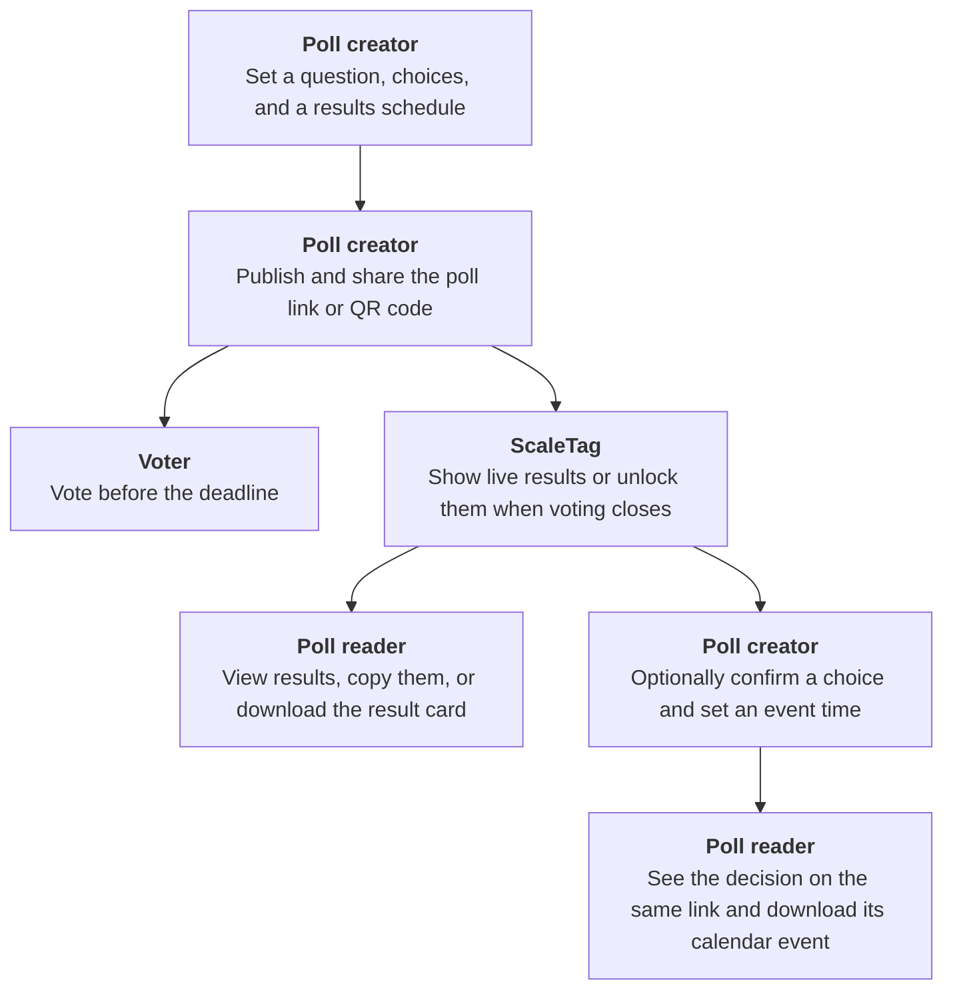

Open poll management to confirm the group’s choice. Confirming ends any open voting and publishes the decision on the original link. An optional event start and end give readers an `.ics` they can import into their own calendars. If the decision or time changes, share the original link again so participants can see the update and download the revised event.

### Tasks and replies

[Post a task](https://www.scaletag.top/create/task) with a description and reward. When a task accepts replies, readers submit a public message, an optional public name, and a phone number or email in separate private fields. The sender's browser encrypts those contact fields. The task publisher can decrypt them in their browser with the management password. Participants arrange the work and any reward directly. ScaleTag does not process payments.

Readers can sort public replies oldest or newest first. After submitting, they can open, copy, or save a link to their individual reply. The publisher can select a respondent privately, which pauses new replies. They can reopen the task or finish it with **Completed** or **Closed**, both final states. The task and replies leave the website 30 days after publication. [Task help](https://www.scaletag.top/help#tasks)

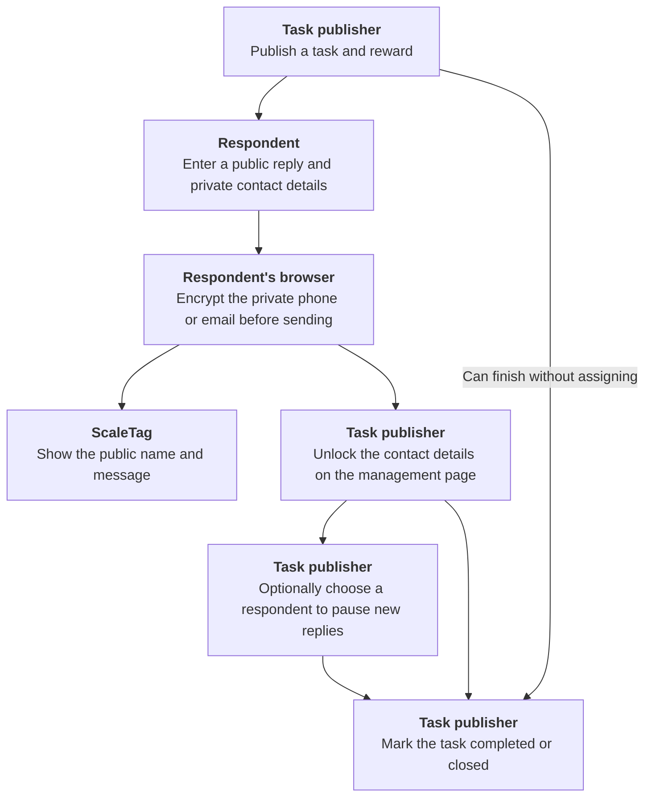

### Wanted posts

[Ask for a free item](https://www.scaletag.top/create/wanted), such as moving boxes or a spare lamp. A donor can reply with a public message and separately encrypted contact details. Use the management password to read those details, choose a donor if needed, and mark the item received when you have it. That closes the request to new offers. Use the **Wanted** filter in PostList or the map to browse these posts. Link-only requests stay out of discovery. [Wanted help](https://www.scaletag.top/help#wanted)

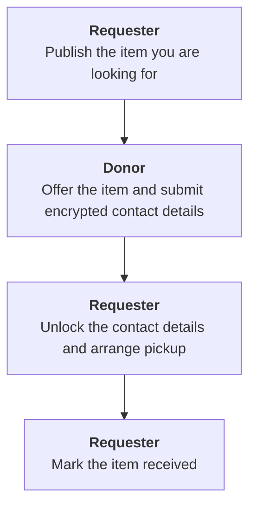

### Found items

[Publish a found item](https://www.scaletag.top/create/found) with the approximate area, time, and a general description. Keep distinctive features private so the owner can describe them. In PostList or the map, choose **Found items** to find nearby notices. A claimant sends identifying details and an email or phone number. Their browser encrypts the claim for the finder, who can use the management password to review it, arrange a return, and mark the item returned. [Found items help](https://www.scaletag.top/help#found)

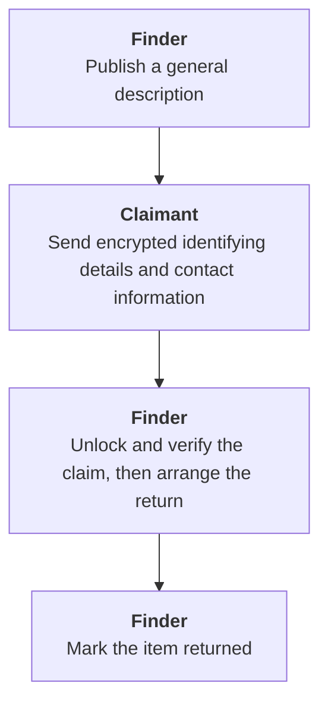

### Free giveaways

[Publish a giveaway](https://www.scaletag.top/create/sale) for direct pickup or pickup by request, with an optional pickup window. Pickup times use the viewer’s device time zone and show the UTC offset, including both offsets when the window spans a daylight-saving change. For direct pickup, visitors can copy the pickup directions or download a calendar entry when the item is available. For pickup by request, the visitor proposes a time without signing in, then checks the same browser for confirmation. The publisher selects one request in the management page. Only that browser can retrieve the exact instructions while its hold is active. The hold ends one hour after the proposed pickup time or when the giveaway expires, whichever comes first. The visitor can cancel and the publisher can release the hold.

The publisher can hold the item until a chosen time or release it sooner. Marking it claimed removes it from discovery and hides the pickup details. The original link shows the claimed status until the giveaway expires 72 hours after publication. Active storage retains the record until day 30. [Giveaway help](https://www.scaletag.top/help#giveaways)

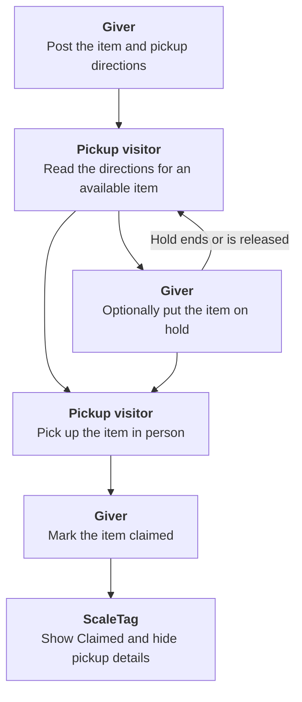

### Secrex

[Create a Secrex secret](https://www.scaletag.top/secrex) to send text for one reading session. Choose when the unread link expires (15 minutes, 1 hour, 1 day, or 7 days). The sender's browser encrypts the secret and provides a link, a QR code, and a separate share password. Send the link or QR code and the password through separate channels. The first valid claim opens a session that ends after at most five minutes or at the original expiry, whichever comes first. The reader can select **End and destroy**. The browser also generates a private code the sender can use to revoke an unopened secret. Secrex is excluded from PostList and the ScaleTag post archive. [Secrex help](https://www.scaletag.top/help#secrex)

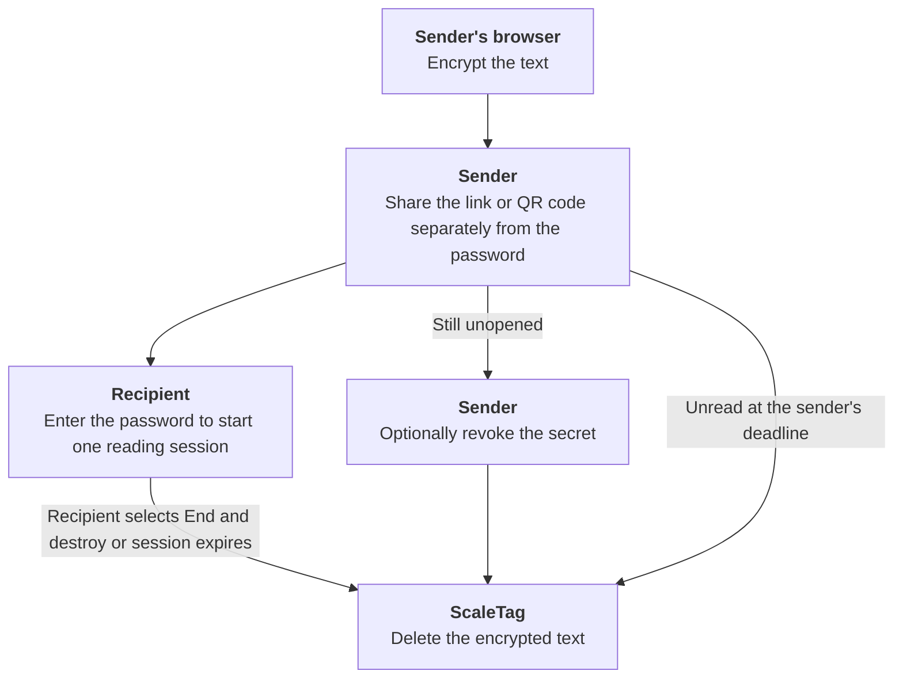

### Discovery, maps, and sharing

[PostList](https://www.scaletag.top/PostList) combines discoverable polls, tasks, and giveaways in a list and an optional map. Search titles and descriptions, choose a post type and status, or filter giveaways to **Pickup now** or **Starts in the next 24 hours**. For nearby search, use GPS or choose an area on the map. Choose a radius of 2, 10, 50, or 100 km and sort by newest or nearest. ScaleTag uses search coordinates for the current request and discards them afterward.

Public discovery requires a publishing location. The publication form asks for consent to show an approximate location on the map. Only posts with consent appear on the map. Nearby search and public map pins use post locations rounded to a 0.01° grid. The optional map loads tiles from OpenFreeMap. Choose **Anyone with the link** to skip GPS and publish outside PostList and the map. Anyone with the public link or QR code can open a link-only post.

Post pages offer link copying, QR downloads, and printable A4 posters while the post is available. On supported browsers they also offer the system share sheet. **Copy public filter link** shares only the chosen post type, status, and pickup filter. Browser Back or **Back to PostList** can return you to the previous view and restore its public filters and the result you opened. Direct visits link back to the default PostList. [Discovery help](https://www.scaletag.top/help#discovery)

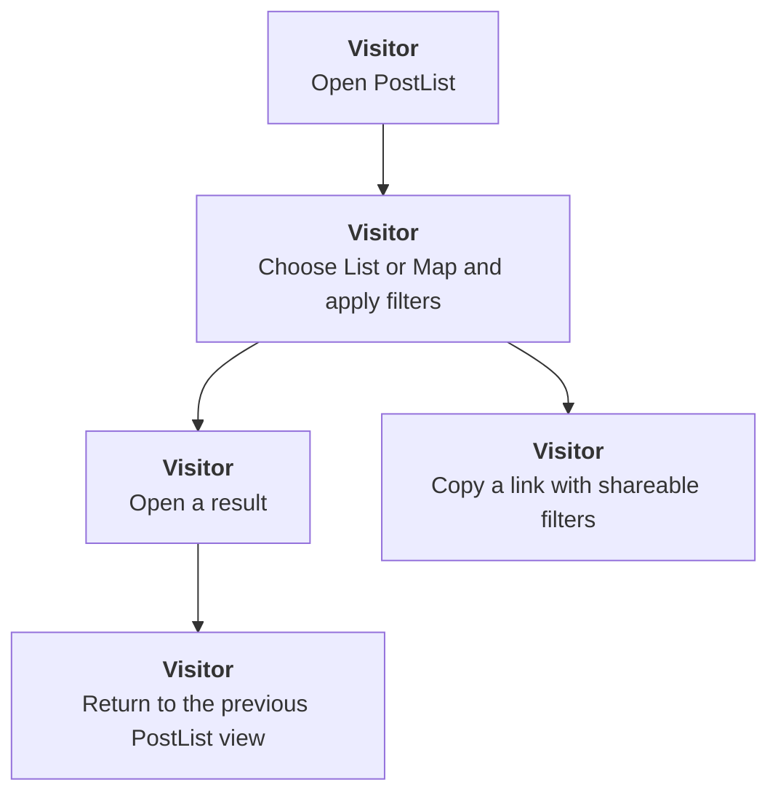

### Public and link-only publication

The web form requires GPS and consent to show an approximate area on the map for a public post. A link-only post skips GPS and is available to anyone who has the link. Uploaded images are re-encoded to remove metadata. Check visible details such as names or addresses before uploading. [Publication and photo help](https://www.scaletag.top/help#publishing)

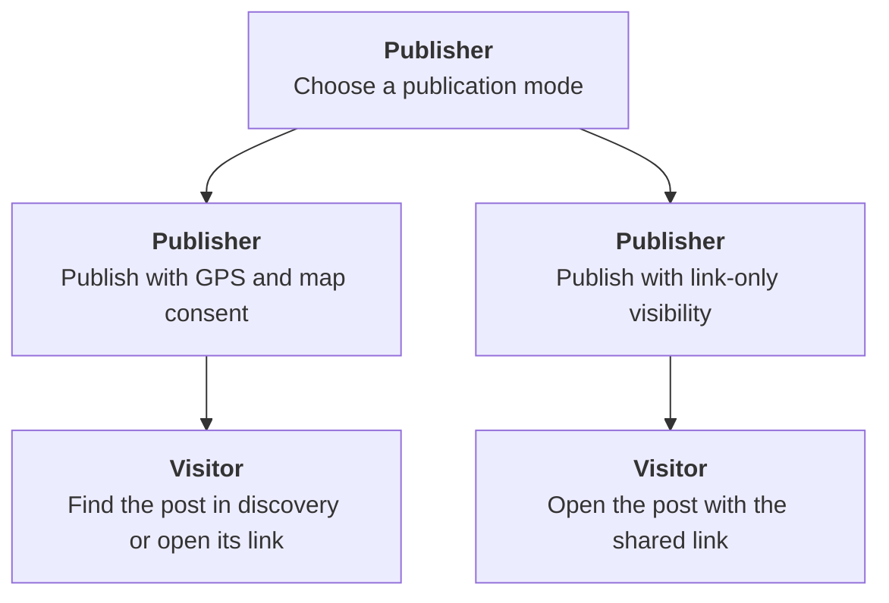

### Post management and text drafts

When publishing a poll, task, or giveaway, save the management URL and its separately generated password. Open the management URL and enter the password to unlock the page. Use **Show password** to check what you typed before submitting. From the management page, you can share the public URL, update supported fields and photos, or change the post's state. Keep the management details private.

The publication forms save draft text and selected form settings in the current browser. The drafts exclude photos, GPS coordinates, management credentials, and replies. If another tab changes the same draft, the form pauses autosave and lets you choose which text to keep. **Copy to new draft** starts a draft of the same type from selected public text and, for polls, the voting choices. It uses the new form's defaults for publication settings and leaves behind pickup directions, pickup times, photos, and credentials. [Management and draft help](https://www.scaletag.top/help#manage)

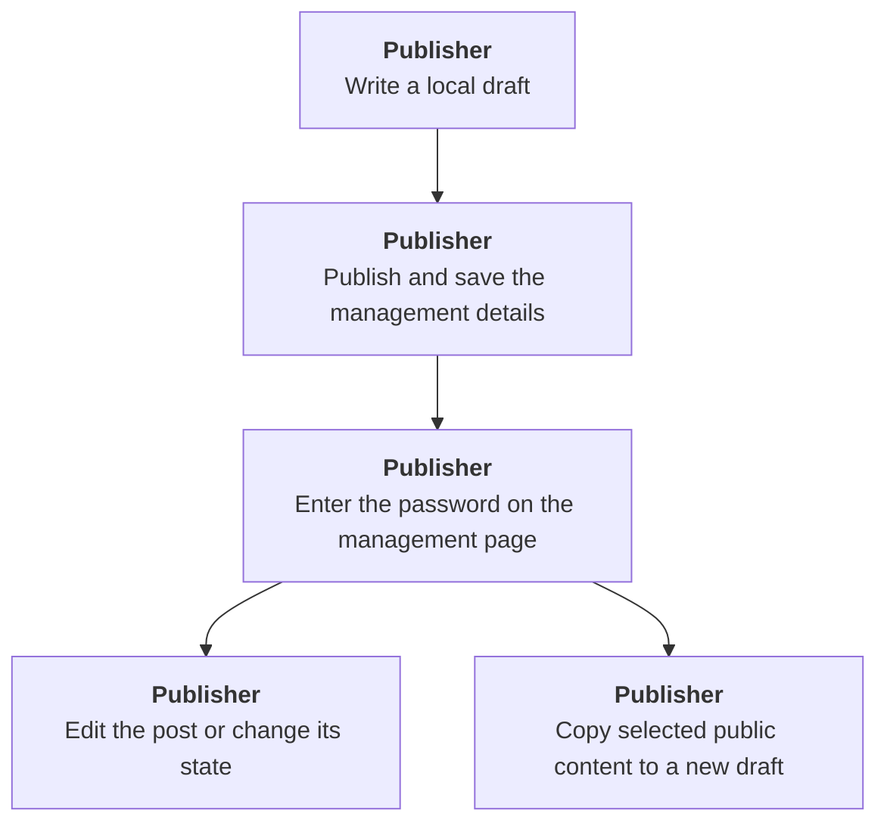

### Saved links

[Saved links](https://www.scaletag.top/saved) can store a public post, a management page, or an individual public task reply in the current browser. Search saved titles, filter by type or link availability, copy a URL, or remove a link and undo the last removal. A saved management URL still requires the separate password on newer posts. When the reply is available, its saved link opens the specific public reply. The saved list shows the parent task's link status. After opening a saved link in the same tab, browser Back restores the previous search and filters from this browser’s history and returns focus to the link if it is still visible. [Saved links help](https://www.scaletag.top/help#saved)

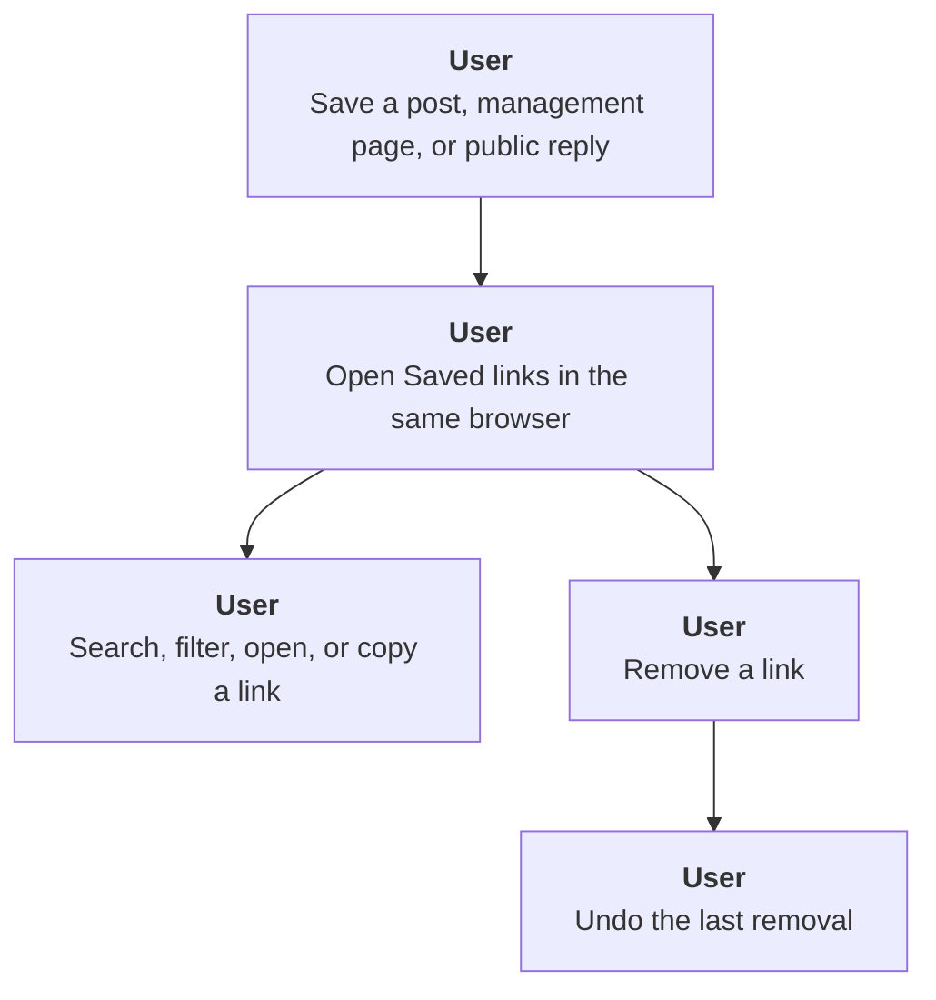

### Installation and offline use

[Install ScaleTag](https://www.scaletag.top/install) from a supported browser to add it to your home screen or apps. After the service worker has cached the interface files, the offline page lets you browse saved links in the same browser and retry the original page after reconnecting. Opening a post, checking live status, and submitting changes all require a connection. The service worker caches selected interface files and the offline page. Private management data and live post content stay out of that cache, and the app does not queue offline submissions. [Install and offline help](https://www.scaletag.top/help#offline)

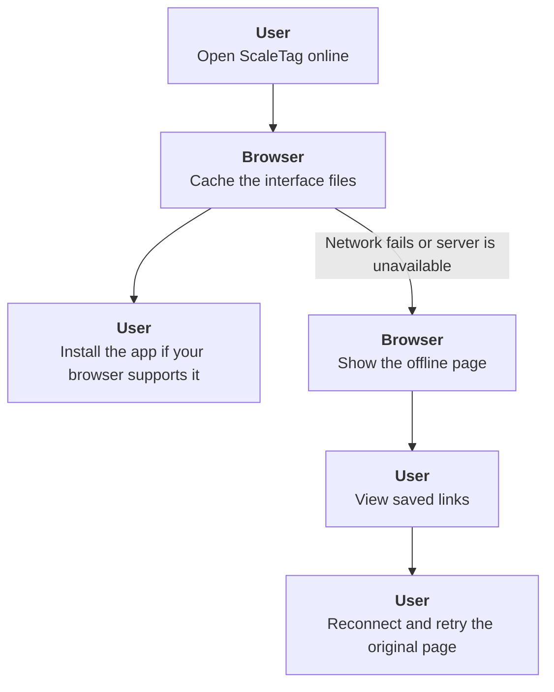

### Anonymous reports

Readers can report a poll, task, or giveaway once per browser cookie. The sixth distinct report freezes the post, removes it from discovery, and blocks its detail and management pages. The default configuration keeps the post frozen through its normal retention period. An optional deployment setting enables report reasons and administrator review. [Reporting help](https://www.scaletag.top/help#reports)

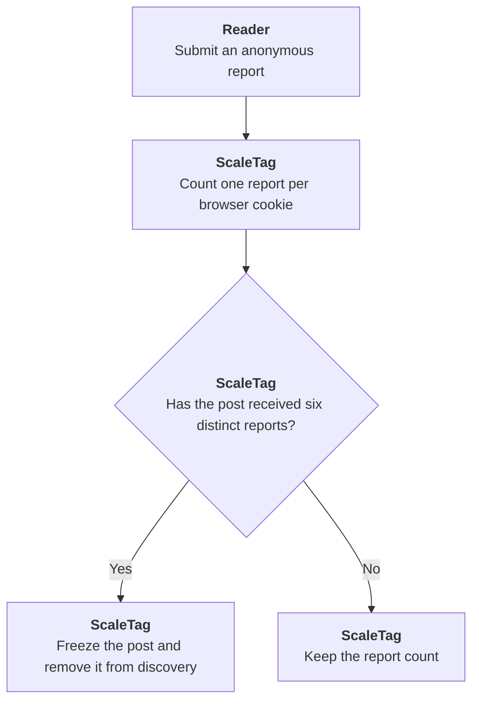

### Visit counters

The home page and discoverable polls, tasks, and giveaways show distinct-browser counts for the past 7 and 30 days. Returning from the same browser updates its latest visit. The Canadian and Japanese deployments count separately. Link-only posts, management pages, and Secrex links are excluded. [Visit count help](https://www.scaletag.top/help#visits)

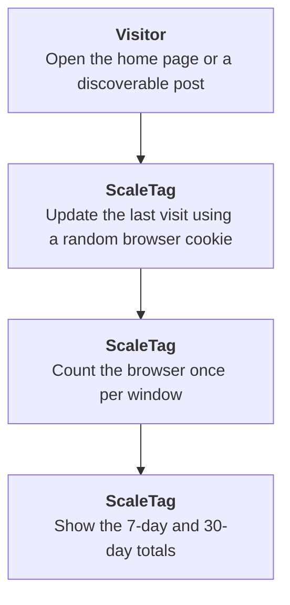

| Page | Path |
| --- | --- |
| Publish | [Poll](https://www.scaletag.top/create), [task](https://www.scaletag.top/create/task), [giveaway](https://www.scaletag.top/create/sale), [Secrex](https://www.scaletag.top/secrex) (also `/create/secrex`) |
| Discover | [PostList](https://www.scaletag.top/PostList) and its optional map |
| Saved links | [`/saved`](https://www.scaletag.top/saved) |
| View a post or secret | `/vote/<id>`, `/task/<id>`, `/sale/<id>`, `/secrex/<id>` |
| Manage a post | `/vote/<id>/manage`, `/task/<id>/manage`, `/sale/<id>/manage` |
| Install and learn about the app | [Install](https://www.scaletag.top/install), [help](https://www.scaletag.top/help), [privacy](https://www.scaletag.top/privacy) |

## Production architecture

```text
Browser ─ HTTPS ─ Cloudflare Tunnel ─ Nginx on OCI host in each region
                                       ├─ app1 (primary) ─┐
                                       └─ app2 (standby) ─┴─ encrypted SQLite
```

- **Ingress and runtime.** Canada and Japan each run a separate installation. In each region, Nginx forwards to two Node.js 24 containers on the same host. The primary and standby share local storage. This provides app-instance failover, with the host and local disk as shared failure points.
- **Storage.** SQLite is the production store. The `posts.id` primary key identifies each post, and `posts.document` contains its full JSON record, including uploaded images. SQLite transactions protect state changes, voting and like deduplication, and shared rate limits.
- **Encryption.** SQLCipher encrypts SQLite pages on disk. Both instances receive the database key from root-managed host configuration at runtime. Daily backup exports use authenticated AES-256-GCM encryption. Administrators with the necessary access can read application records, which contain ciphertext for browser-encrypted reply contacts. See [encryption and recovery](docs/encryption.md) for the storage formats and restore tools.
- **Delivery.** Standard releases follow a two-workflow pipeline:
  1. **Test, build, and publish ([`.github/workflows/ci.yml`](.github/workflows/ci.yml)).** On GitHub-hosted `ubuntu-latest` runners, the `test`, `container`, and `ha` jobs run syntax checks (`npm run check`), production dependency auditing (`npm audit --omit=dev --audit-level=high`), Node unit, security, and privacy tests (`npm test`), Python unit tests, Playwright browser tests (including report-freeze and task contact privacy checks), container smoke tests, and HA failover integration tests. Only after all test jobs pass on `main` (on push or `workflow_dispatch`) does the `publish` job build the multi-platform image (`linux/amd64,linux/arm64` by default) and upload it to Docker Hub tagged by exact commit SHA.
  2. **Pull and deploy ([`.github/workflows/deploy.yml`](.github/workflows/deploy.yml), [`deploy/deploy.sh`](deploy/deploy.sh)).** Triggered by a successful `Build and Publish Image` run on `main` (or `workflow_dispatch` on `main`), the self-hosted runners for Canada (`[self-hosted, ocihost]`) and Japan (`[self-hosted, ocijphost]`) check out that commit, reject stale revisions that no longer match `main`, and run [`deploy/deploy.sh`](deploy/deploy.sh) to pull the prebuilt commit-SHA image, run a pre-deployment backup when `scaletag-backup.service` is installed, update the standby (`app2`) before the primary (`app1`), verify `/readyz` on each slot and ingress, and roll back to the previous slot images if readiness checks fail. Host environment and backup configuration live outside the public application repository.

## Traffic and publication statistics

Canada and Japan count independently. The homepage footer counts distinct browsers for the site, and a public poll, task, or giveaway footer counts distinct browsers for that post. Each browser contributes once to each 7-day or 30-day window. Reloading updates the last visit. The count uses a random 30-day browser cookie, with separate hashes for the site and individual posts. Browsers that clear the cookie are counted again. Visits use successful public HTML requests, including visits without JavaScript. They exclude API and asset requests, management pages, Secrex share links, failed requests, and recognized browser prefetches. Counters use UTC hour buckets and include the current hour plus the preceding 167 or 719 hours. Deduplicated counts begin when the visitor counter starts collecting. Older raw page-view records age out under the same 30-day policy.

- `GET /api/visits` returns `days7` and `days30` for the current site.
- `GET /api/visits/{poll|task|giveaway}/{id}` returns the same fields for a public post.
- `GET /api/stats` is an operations endpoint on each installation's local ingress. On either host, query it with `curl --fail http://127.0.0.1:3000/api/stats`. The response contains the site origin, the collection start and snapshot timestamps, and the visit and publication counts for both windows. Publication counts cover creations within each period. A destroyed Secrex still contributes to the aggregate creation count. The endpoint returns no secret IDs or contents.

The existing Kuma Push monitor for each region displays four space-separated pairs for site visits, polls, tasks, and giveaways. Each pair shows the 7-day count followed by the 30-day count, such as `2/2 1/1 0/0 3/3`. The collector preserves the health status and response time and falls back to the original message if statistics cannot be read.

## Browser encryption for task reply contacts

ScaleTag encrypts the separate phone and email fields of a task reply in the reply author's browser. The publisher can decrypt them in their browser with the task management password. The reply author does not need that password. This protection applies to those contact fields, not to the whole post or reply: the task content, reply name and reply message are public. Do not put private contact information in a public name, message, image or other public field.

**Publishing a task.** In a secure browser context, Web Crypto generates a 32-byte random management password (shown as 64 hexadecimal characters) and a fresh ECDH P-256 key pair for the task. The browser derives an AES-256-GCM wrapping key from the password with HKDF-SHA-256 and a random 16-byte salt, then encrypts the task private key with a random 12-byte nonce. The task public key is authenticated as additional data. The browser sends the public key, encrypted private-key envelope and a separately derived authentication credential to the server; it does not send the management password itself for task authentication. Save both the management URL and password. The password is not embedded in the URL.

**Sending a reply.** The sender's browser retrieves the task public key and generates a fresh ephemeral ECDH P-256 key pair. It combines the ephemeral private key with the task public key to derive a shared secret, then derives an AES-256-GCM key with HKDF-SHA-256. A fresh 12-byte nonce is used as the HKDF salt; the two public keys and task ID are included in the derivation context and authenticated data. The browser encrypts the provided phone and/or email as JSON and sends the ciphertext, nonce and ephemeral public key to the server. The server stores the encrypted contact envelope; the sender need not know the task password.

**Viewing contacts.** The publisher enters the password on the management page. The browser derives an authentication credential and sends it to the server over HTTPS. After verifying it, the server returns management data including the wrapped task private key and encrypted reply contacts. The browser derives the wrapping key from the password, decrypts the task private key, combines it with each reply's ephemeral public key, and decrypts the contact locally. AES-GCM checks integrity; an incorrect password or altered authenticated data causes decryption to fail. The publisher can copy, save or share the resulting plaintext.

**Authentication and encryption have different jobs.** The browser derives the task authentication credential from the same random password using HKDF-SHA-256 with a separate label. The server stores an Argon2id verifier of that credential and uses it to authorize management requests. The credential grants management API access, but it is not the wrapping key and does not by itself decrypt the contacts. Database page encryption and encrypted backups are additional storage protections; possessing stored records or storage keys alone does not provide the task password or plaintext contact fields. Both envelopes are versioned, binary components are Base64 encoded, and AES-GCM uses a 128-bit authentication tag.

**If the password is lost.** ScaleTag cannot reset the task password or recover the encrypted contacts from stored data or backups. Keep the password safe; anyone with it can derive the management credential and decrypt the contacts. HTTPS protects data in transit. Browser-side encryption depends on the code and environment running in the browser and does not protect information a participant discloses elsewhere.

### Cryptographic details

Reply authors can send a phone number or email address without knowing the publisher’s password. The public task key lets a reply author encrypt those fields before sending them, so the application database and backups hold contact ciphertext. The reply name and message remain public. The implementation uses Web Crypto in a secure browser context. See [`public/task-crypto.js`](public/task-crypto.js).

1. **Publish.** The browser generates the task management password from 32 random bytes (256 bits) and encodes it as 64 hexadecimal characters. It generates a per-task ECDH P-256 key pair and exports the public key as SPKI and the private key as PKCS#8. HKDF-SHA-256 derives an AES-256-GCM key from the password bytes using a random 16-byte salt and the `scaletag:task:private-key-wrap:v1` label. The browser encrypts the private key with a random 12-byte nonce and authenticates the public key as additional data. It sends the public key, wrapped private key and a separately derived authentication credential to ScaleTag. The task password stays in the browser during publication and management and stays out of the URL.
2. **Reply.** The sender’s browser gets the task public key and creates a fresh ECDH P-256 key pair for the reply. ECDH produces a 256-bit shared secret. HKDF-SHA-256 uses the 12-byte random AES-GCM nonce as its salt and includes both public keys and the task ID in its derivation context. AES-256-GCM encrypts the phone and email JSON with both public keys and the task ID as additional authenticated data. The server stores the sender’s ephemeral public key, nonce and ciphertext. Both encryption envelopes are versioned and encode binary fields in Base64. AES-GCM uses the Web Crypto default 128-bit authentication tag.
3. **Manage.** After verifying the separate authentication credential, ScaleTag returns the wrapped private key and encrypted reply contacts. The publisher’s browser uses the password to unwrap the private key, repeats the key agreement for each reply and displays the decrypted contacts. Save the management URL and password when publishing. If you lose the task password, ScaleTag cannot reset it or recover the encrypted contacts, even from a backup.

Access to stored records or storage encryption keys alone leaves the new contacts encrypted. The task publisher can save or share contacts after viewing them.

## Secrex one-time encrypted secrets

Secrex ([`/secrex`](https://www.scaletag.top/secrex), [`/create/secrex`](https://www.scaletag.top/create/secrex)) lets users share sensitive text (up to 12,000 bytes plaintext) for a single reading session without creating an account or appearing in `PostList`. See [`public/secrex-crypto.js`](public/secrex-crypto.js), [`public/secrex.js`](public/secrex.js), [`src/secrex.js`](src/secrex.js), and [`src/secrex-store.js`](src/secrex-store.js).

1. **Client-side encryption and key separation (`secrex-v1`).** In a secure browser context, Web Crypto generates a 16-byte random ID (22 base64url characters), a 32-byte random share password (43 base64url characters), and a fresh 256-bit data encryption key (DEK). Using HKDF-SHA-256 with the raw ID bytes as salt, the browser derives two separate keys from the password:
   - A 32-byte claim credential (`secrex-v1-claim`) sent to the server for access verification.
   - A 256-bit AES-GCM wrapping key (`secrex-v1-wrap`) that stays in the browser.
   The browser encrypts the plaintext with the DEK (`AES-256-GCM`, 12-byte random nonce) and wraps the DEK with the wrapping key (`AES-256-GCM`, 12-byte random nonce). Both ciphertexts authenticate length-prefixed AAD binding `secrex-v1`, the secret ID, and the purpose (`body` or `wrap`).
2. **Split delivery.** The browser displays `/secrex/<id>`, a QR code (`/api/secrex/<id>/qr.png`), and the generated share password. Neither the URL nor the QR code carries the password or wrapping key; senders should transmit the link/QR code and the password through separate channels.
3. **Server verification, single session, and destruction.** `SecrexStore` stores the ciphertext envelope and an Argon2id v1.3 verifier (`m=65536` KiB, `t=3`, `p=1`, 16-byte random salt) of the claim credential in a dedicated `secrex.sqlite` database (`PRAGMA secure_delete=ON`), deliberately excluded from the ScaleTag post archive. On `POST /api/secrex/:id/claim`, the first valid claim and random 32-byte session token lock the record inside an immediate SQLite transaction for up to 5 minutes (`sessionMs = 300000`), capped at the sender’s original expiry and rejecting competing devices or tabs. A successful **End and destroy** request (`POST /api/secrex/:id/end`) deletes the payload row. Closing the reading page clears the displayed text. Server cleanup deletes the payload when the 5-minute session or the chosen unopened lifetime expires (seven days by default). Deletion leaves only minimal metadata (`id`, `created_at`, `state`, `finished_at`) in `secrex_history`.

4. **Sender revocation.** A private code lets the sender revoke an unopened secret. The server stores a verifier for the independently generated random code. Revocation competes with the first valid claim in a database transaction and cannot retrieve or decrypt a payload. Keep the code separate from the recipient link and password.

## Argon2id management passwords

For tasks, the browser derives a 256-bit authentication credential from the decoded password bytes using HKDF-SHA-256, the fixed salt `scaletag:task:hkdf-salt:v1` and the separate label `scaletag:task:auth-key:v1`. It sends the credential as 64 hexadecimal characters at publication and when requesting management data or changing task status. The credential grants access to the management API. Decrypting the new contact ciphertext requires the private key protected by the task password.

For new polls and giveaways, the server generates a separate 32-byte random password, encodes it as 64 hexadecimal characters and returns it once in the uncached creation response. The browser sends that password for verification. Polls created before management was introduced retain their original public links and voting behavior. Both flows send the management credential in a same-origin JSON POST over HTTPS in production. The management page can copy the URL and password together as text.

### Hashing parameters

ScaleTag uses [@node-rs/argon2](https://github.com/napi-rs/node-rs/tree/main/packages/argon2) to produce an [Argon2id v1.3](https://www.rfc-editor.org/rfc/rfc9106) verifier for a task authentication credential or a poll or giveaway management password. The production SQLite post document stores the verifier in `manageKeyHash` as a PHC string containing the algorithm, version, parameters, salt and derived hash.

| Setting | Value |
| --- | --- |
| Variant and version | Argon2id, `v=19` (0x13) |
| Memory | `m=19456` KiB (19 MiB) per operation |
| Time cost | `t=2` passes |
| Parallelism | `p=1` lane |
| Salt | 16 random bytes generated separately for each verifier |
| Derived hash | 32 bytes |

### Verification and compatibility

The server checks the submitted credential’s format, then verifies it before opening the SQLite write transaction. It rechecks the current post and its verifier inside the transaction before returning private information or changing state. Each application process permits two concurrent Argon2 operations. Excess work receives HTTP 429. Public responses omit the verifier.

The server also supports older management links with SHA-256 verifiers. SQLCipher separately encrypts the SQLite database pages at rest.

## Data and retention

- Pickup requests store the proposed time and a hash of a random, per-giveaway browser cookie. Requesters are not asked for contact details. The pickup address remains private during the giveaway and is served only to the publisher and the selected browser during an active hold.
- Poll votes use a per-poll random cookie. Likes, replies and reports share a separate per-post random cookie. Server-side deduplication uses hashes. Vote hashes are cleared after voting ends. The application has no account or fingerprinting system and does not keep HTTP access logs. Infrastructure providers and host security logs can still process connection information.
- Each browser cookie can report a post once. A sixth distinct report freezes the post, including its detail page and management access, and removes it from the list and map. The default mode keeps the post frozen through its regular retention period.
- Uploaded photos are re-encoded and their metadata is stripped. Anything visible in a photo remains visible to viewers. External HTTPS images load on request from their hosts. The optional map uses OpenFreeMap, which receives requests from the viewer’s browser.
- The installable app caches selected interface assets and a generic offline page. It does not cache private management data or queue offline submissions.
- The service removes posts from active storage at day 30, with cleanup running on startup and approximately every 30 seconds during normal operation. Backups may contain earlier copies. Each backup is retained for up to 90 days after the backup was made, so the last archived copy of a post may remain for about 120 days after publication. Recovery preserves original expiry dates.

## Optional report review

The default `SCALETAG_REPORT_REVIEW=0` keeps anonymous reports and automatic freezing. To collect report reasons and allow review on a SQLite deployment, set `SCALETAG_REPORT_REVIEW=1` in its environment configuration and recreate the application containers. New reports still use the same freeze threshold. The public site sees the reason selector, while category totals stay in the server database.

An administrator can use the running container's existing database permissions. The following commands use the HA Compose project:

```bash
docker compose -f compose.ha.yaml exec -T app1 node src/report-review.js list
docker compose -f compose.ha.yaml exec -T app1 node src/report-review.js show POST_ID
docker compose -f compose.ha.yaml exec -T app1 node src/report-review.js photo POST_ID 1 > photo.png
docker compose -f compose.ha.yaml exec -T app1 node src/report-review.js restore POST_ID
```

The `show` command lists photo numbers and formats. Use the original format when saving a photo for local inspection. The review tool does not fetch external image links. Restoring clears the active reports on that post and leaves its original expiration and publication settings in place. Frozen posts that have already expired or were withdrawn stay unavailable.

## Run locally

Use Node.js 22 or later. Native development defaults to the single-writer JSON store and serves HTTP on loopback.

```sh
npm ci --ignore-scripts
npm rebuild better-sqlite3-multiple-ciphers
npm start
```

Open [http://127.0.0.1:3000](http://127.0.0.1:3000). Configure the app with environment variables listed in [`.env.example`](.env.example). Production requires an HTTPS `PUBLIC_ORIGIN`. Use a separate data directory for local tests.

- [`compose.yaml`](compose.yaml) runs the single-instance development topology.
- [`compose.ha.yaml`](compose.ha.yaml) defines Nginx and two instances sharing SQLite.
- [HA setup and migration reference](docs/ha-demo.md) describes the Compose topology and historical conversion steps.

## Verification

```sh
npm run check
npm test
npx --no-install playwright install chromium
npm run test:pwa
npm run test:map
npm run test:tasks
npm run test:secrex
npm run test:sales
npm run test:locale
node --test test/reports.browser.mjs test/poster.browser.mjs test/task-contact-privacy.browser.mjs
python3 -m unittest discover -s test -p '*_test.py' -v
```

For container and failover checks, follow the [GitHub Actions workflow](.github/workflows/ci.yml). Tests use disposable data, so they can exercise expiry, private replies, Argon2id verification and recovery without touching production records.

## Public text filtering and attribution

ScaleTag blocks terms from the bundled `data/ldnoobw` lists (`en`, `zh`, `fr`, `fr-CA-u-sd-caqc`) server-side across all user-created public text (poll titles, descriptions, signatures, and options; task titles, descriptions, rewards, and signatures; giveaway titles, descriptions, pickup locations, and signatures; and public reply names and messages). The upstream lists in `data/ldnoobw` are kept unmodified; at load time, single Han-character entries and letterless digit entries (such as `13.`) are generically omitted so normal Chinese phrases (such as `牛奶` or `安全性`), numbered items, and dates are not blocked, while multi-character Chinese entries and letter-bearing mixed terms remain active. Latin and digit edges enforce script-aware word boundaries to avoid matching substrings inside innocent words (such as `class`, `document`, `posting`, or `Peter`), while multi-character Chinese terms match within unspaced text.

**Coverage limitations:** Filtering is strictly lexical against those four static snapshots; it does not catch obfuscations (leetspeak, inserted separators, homoglyphs), context-dependent abuse, images, or end-to-end encrypted private task contacts. Because single Han-character entries and letterless digit entries (`13.`) are omitted to prevent false positives on benign Chinese compounds and numbers, standalone single-character Chinese profanity and standalone `13.` are not automatically blocked unless covered by a retained multi-character entry; standalone cross-language homographs may still be blocked. See [public text filtering documentation](docs/word-filter.md) for full details and limitations.

**Attribution:** The wordlists in [`data/ldnoobw/`](data/ldnoobw/) are unmodified upstream files from [List of Dirty, Naughty, Obscene, and Otherwise Bad Words (LDNOOBW)](https://github.com/LDNOOBW/List-of-Dirty-Naughty-Obscene-and-Otherwise-Bad-Words), used under the [Creative Commons Attribution 4.0 International License (CC BY 4.0)](data/ldnoobw/LICENSE) (`https://creativecommons.org/licenses/by/4.0/`) and provided "AS-IS" without warranties.

## License

[MIT](LICENSE) (application code; wordlists in `data/ldnoobw/` are CC BY 4.0)
